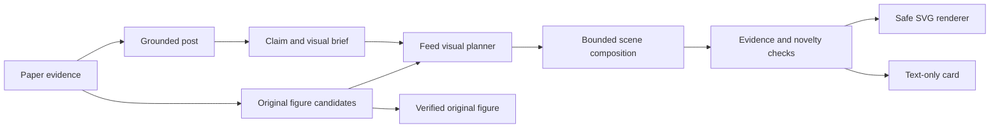

# Proposal: plan visuals across the feed

Status: proposed architecture, not implemented. The system theme and desktop layout changes are separate UI work.

## Observed failure

In the local quantum-error-correction feed, three of four concept illustrations use `pipeline`: uncertainty transfer/reset, decoder power signatures, and neural error correction. Their labels and colours differ, but `illustrationFigure()` draws the same three circles and two arrows.

The text worker chooses `IllustrationSpec {layout, labels, accent, caption}` independently for each paper. The renderer has a closed set of fixed compositions. Neither component knows which nearby visuals have already appeared. Adding more templates or asking for “variety” cannot guarantee a different or more informative picture. The post cache also stores the rendered illustration alongside the prose, freezing that decision before feed context exists.

## Recommended architecture

Move concept design out of post writing into a server-side visual planner. Plan from the supported claim, then compose a scene, rather than choosing a stock picture by topic.



The planner chooses a suitable original figure, a useful concept scene, or no image. Variety never justifies an inaccurate diagram.

### 1. Evidence-linked visual brief

A brief contains the one claim to explain, exact supporting passages, entities, their relationship, the evidence setting, and what must not be implied. It distinguishes a proposed device, an animal experiment, a simulation and a theorem. The text worker stops producing layout/colour choices; it emits the supported prose and evidence only.

For theory, the brief can describe the question or relationship rather than pretending there is an experimental result to plot. If the idea cannot be depicted faithfully and clearly, the planner returns `none`.

### 2. Composable, bounded scene schema

Replace the live `layout` enum with a validated `ConceptScene` built from a small vocabulary of shapes, semantic objects, groups, labels and explicit relationships. Composition can be a cycle, branch, chain, containment, spatial topology, or another supported arrangement. An object can contain other objects; two unrelated papers need not share geometry merely because both have an input and output.

Use bounded counts and geometry, finite coordinates, minimum font sizes, label bounds, and escaped text. No arbitrary SVG, scripts, HTML, external images or model-supplied executable code. The renderer owns coordinates and routes connectors to prevent overlaps. Original figures keep their existing bitmap/crop path; they are never redrawn.

Candidate schema boundary:

```ts
type VisualBrief = {
  paperId: string;
  claim: string;
  evidence: string[];
  entities: { id: string; label: string; role: string }[];
  relationships: { from: string; to: string; meaning: string }[];
  avoidImplying: string[];
};

type PlannedVisual =
  | { kind: 'source'; candidateId: string }
  | { kind: 'concept'; scene: ConceptScene; evidence: string[] }
  | { kind: 'none'; reason: string };
```

`ConceptScene` should be a discriminated, constrained data schema, not free-form model markup. Colour is a renderer/style choice and is excluded from novelty scoring.

### 3. Feed-level selection and novelty checks

Plan a small ordered window (initially four posts) with visibility of earlier visual fingerprints. A fingerprint records semantic object families, graph topology and spatial composition, ignoring colour, labels and paper IDs. Changing purple to green therefore cannot count as a new composition.

Start with two enforceable rules: no identical concept topology/composition on consecutive cards, and no more than one generic three-step flow diagram in a four-card window. Similarity thresholds should be tuned from reviewed feeds, not maximised blindly. A repeated but genuinely necessary representation can instead be omitted or explained in text.

If a plan repeats, allow one bounded revision from the same evidence. If that fails validation, use a verified source image or no illustration. Never choose a scientifically unrelated layout just to meet a diversity quota. Record the decision reason for evaluation without logging visitor keys or personal instructions.

### 4. Concrete quantum examples

| Supported idea | Useful composition | Why it differs |
| --- | --- | --- |
| Error checks transfer uncertainty; checking equipment must be reset | Protected memory contained within a boundary; a check/reset loop outside it | Explains a repeating cycle and the protected boundary |
| Decoder power signatures reveal an error label | Main correction path with a side branch from power use to an observer | Shows the information leak rather than a generic processing chain |
| Neural decoder maps error signals to corrections | Error locations grouped separately from the correcting action | Makes the input/output distinction concrete without inventing measured outcomes |
| Routing overhead differs between one- and two-dimensional layouts | A chain and a grid with equal, explicitly conceptual node counts | Encodes the spatial distinction instead of comparing anonymous shapes |

These are explanatory concepts, not invented data plots, measured waveforms or representations of actual chip layouts. Their captions must say so.

## Streaming, caching and cost

Keep the first post fast: emit text immediately, then plan the first visual window when its briefs are ready. Source retrieval can run alongside brief preparation. Patch existing cards through the figure event path; use request cancellation and a short total visual deadline. Reuse the existing `posts-ready` boundary so visual work does not block pagination.

Split caches by responsibility. Cache prose/evidence by source hash, model and editorial version. Cache source figures by their existing verified protocol. Cache validated concept candidates by claim/evidence hash and visual protocol, then select among those candidates using the current feed's fingerprints. Do not write a feed-specific selection back into the shared prose cache. Return the selected figure with the card so bookmarks preserve what the reader saw.

Use GPT-6.1 Terra server-side for new planning/verification calls. Batch briefs for a small window, permit only one repair, and cap the visual budget independently of text generation. Measure incremental latency and tokens before increasing coverage. No visitor key persistence and no owner key in the public service.

## Migration and acceptance

1. Introduce `VisualBrief`/`ConceptScene` schemas and offline renderer checks. Keep curated demo artwork working through its legacy renderer.
2. Add the independent live visual planner and selection cache, replacing the live text schema's mandatory illustration object.
3. Apply fingerprints across pagination and the current ordered feed, and carry them within the bounded discovery snapshot. Cold snapshot recovery can rebuild them from public plan identifiers, never visitor credentials.
4. Re-run the five-topic case study, reviewing actual images rather than counting template names.

Acceptance: the same scene with different labels or colours is detected as a duplicate; the quantum sample's three repeated pipelines cannot all pass. Evidence checks must reject unsupported entities, scales, causal arrows and fabricated charts. Missing/slow/invalid plans leave readable text. New searches cancel work; figure patches survive completion, bookmarks and open explanations. Evaluate diagram usefulness, duplicate composition rate, original-figure coverage, first-post latency, visual latency and tokens. Do not count random variation as an improvement.
